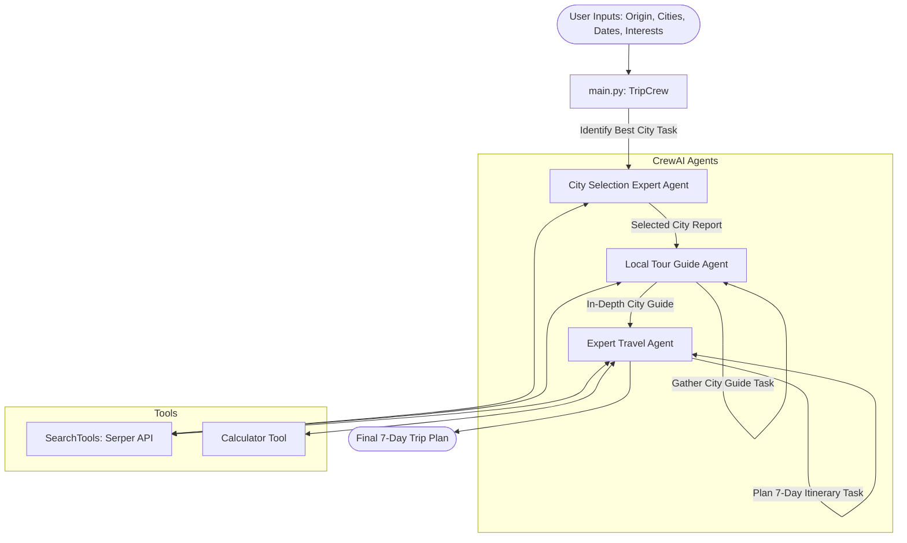

# 🌍 AI Agent Trip Planner

An intelligent, multi-agent travel planning system built with **CrewAI** and **LangChain**. The system leverages collaborative AI agents to analyze destinations, gather real-time city guides, calculate budgets, and generate comprehensive, day-by-day 7-day travel itineraries tailored to user preferences.

---

## 🚀 Key Features

- **Autonomous Multi-Agent Collaboration**: Powered by CrewAI, specialized AI agents collaborate sequentially to research, filter, and plan your journey.
- **Data-Driven City Selection**: Evaluates candidate cities considering weather, seasonality, current events, flight estimates, and traveler interests.
- **Local Insider Guides**: Unearths hidden gems, cultural hotspots, local customs, and top attractions for the chosen destination.
- **Complete 7-Day Itineraries**: Generates detailed daily itineraries including morning/afternoon/evening schedules, hotel recommendations, dining spots, packing lists, and budget breakdowns.
- **Real-Time Web Search & Computation**: Integrates Serper API for live web search and custom tools for budgeting calculations.

---

## 🏗️ Architecture & Workflow

The application employs a collaborative team of specialized agents:



### The Agents & Tasks

1. **City Selection Expert**
   - **Role**: Destination analysis & comparison.
   - **Task**: Evaluates traveler origin, candidate cities, travel dates, and interests against seasonal weather, events, and travel costs to pick the optimal destination.
   - **Tools**: `SearchTools.search_internet`

2. **Local Tour Guide**
   - **Role**: Cultural and local attraction specialist.
   - **Task**: Compiles a comprehensive local guide covering must-visit landmarks, secret spots, customs, seasonal happenings, and local advice.
   - **Tools**: `SearchTools.search_internet`

3. **Expert Travel Agent**
   - **Role**: Master itinerary architect and logistics coordinator.
   - **Task**: Synthesizes the destination analysis and local guide into an actionable 7-day itinerary with verified hotels, dining venues, daily logistics, and an itemized budget.
   - **Tools**: `SearchTools.search_internet`, `calculator_tools.calculate`

---

## 🛠️ Tech Stack

- **Core Framework**: [CrewAI](https://github.com/crewAIInc/crewAI)
- **LLM Orchestration**: [LangChain](https://github.com/langchain-ai/langchain), `langchain-openai`, `langchain-ollama`
- **Search Tooling**: Serper API (`google.serper.dev`)
- **Package Management**: [Poetry](https://python-poetry.org/) & `pip`
- **Runtime**: Python 3.13+

---

## 📂 Project Structure

```text
ai-agent-trip-planner/
├── tools/
│   ├── __init__.py
│   ├── calculator_tools.py   # Math and budgeting tool
│   └── search_tools.py       # Live internet search via Serper API
├── .env.example              # Environment variables template
├── .gitignore                # Git ignore rules for Python & environments
├── agents.py                 # Agent definitions and LLM configurations
├── main.py                   # Application entry point and CLI interface
├── poetry.lock               # Poetry locked dependency tree
├── pyproject.toml            # Poetry project definition & metadata
├── requirements.txt          # Standard pip requirements
├── tasks.py                  # Task specifications and prompts
└── README.md                 # Project documentation
```

---

## ⚙️ Installation & Setup

### 1. Prerequisites
- Python `3.13` or compatible
- [OpenAI API Key](https://platform.openai.com/api-keys)
- [Serper API Key](https://serper.dev/) (for web search capability)

### 2. Clone the Repository
```bash
git clone https://github.com/devanshbansal3912/ai-agent-trip-planner.git
cd ai-agent-trip-planner
```

### 3. Configure Environment Variables
Copy `.env.example` to `.env` and fill in your API keys:
```bash
cp .env.example .env
```
Edit `.env`:
```ini
OPENAI_API_KEY=your_openai_api_key_here
SERPER_API_KEY=your_serper_api_key_here
```

### 4. Install Dependencies

#### Option A: Using Poetry (Recommended)
```bash
poetry install
poetry shell
```

#### Option B: Using Pip & Virtual Environment
```bash
python -m venv .venv

# On Windows:
.venv\Scripts\activate

# On macOS/Linux:
source .venv/bin/activate

pip install -r requirements.txt
```

---

## 🚦 How to Run

Execute the main script:
```bash
python main.py
```

You will be prompted to enter your travel preferences interactively:
```text
## Welcome to Trip Planner Crew
-------------------------------

From where will you be traveling from?
> New York, USA

What are the cities options you are interested in visiting?
> Tokyo, Kyoto, Osaka

What is the date range you are interested in traveling?
> October 10 - October 17, 2026

What are some of your high level interests and hobbies?
> Photography, street food, historic temples, and modern art
```

The Crew will kick off, run the agent tasks in sequence, and output a structured, complete 7-day travel plan.

---

## 🔒 Security & Best Practices

- Never commit `.env` or sensitive API keys.
- Ensure all API keys are passed through environment variables.
- Verify Serper API credit quota before running extensive search workflows.

---

## 👤 Author

- **Devansh Bansal** - [GitHub Profile](https://github.com/devanshbansal3912)

